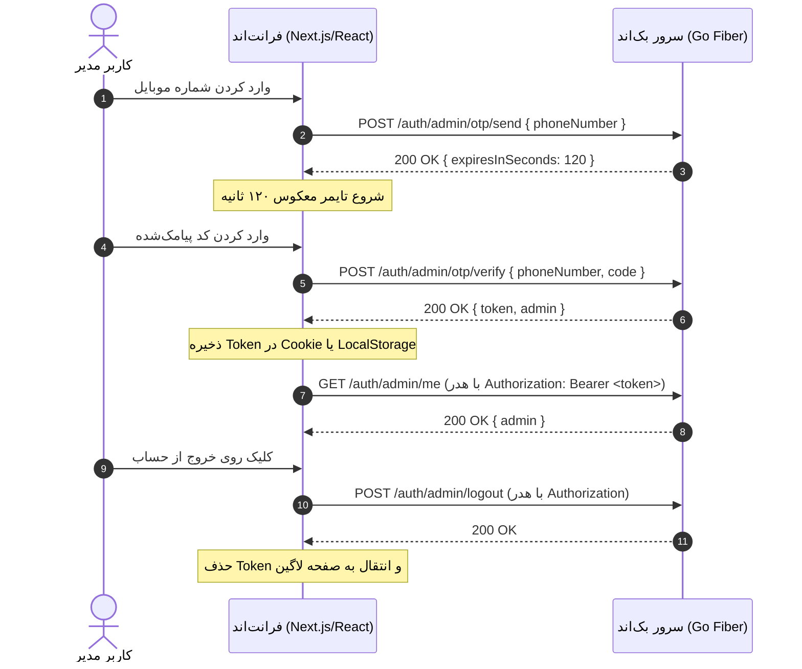

# راهنمای جامع اتصال و مستندات API (Frontend Developer Guide)
**پروژه:** کاتالوگ اختصاصی کفش DYF (DYF Private Catalog)  
**نسخه API:** `v1`  
**آدرس پایه در محیط لوکال:** `http://localhost:8080/api/v1`

---

## ۱. ساختار استاندارد پاسخ‌ها (Response Envelope)

کلیه پاسخ‌های سرور (چه موفقیت‌آمیز و چه خطا) در قالب ساختار یکپارچه پاکت (`Envelope`) به شرح زیر بازگردانده می‌شوند:

### ۱.۱. پاسخ‌های موفق (`success: true`)
```json
{
  "success": true,
  "statusCode": 200,
  "message": "پیام عملیات به فارسی",
  "data": {
    "field": "value"
  },
  "meta": null
}
```

### ۱.۲. پاسخ‌های خطا (`success: false`)
```json
{
  "success": false,
  "statusCode": 400,
  "error": {
    "code": "invalidOTP",
    "message": "کد تایید وارد شده صحیح نیست",
    "details": null
  }
}
```

---

## ۲. هدرهای ضروری درخواست (Request Headers)

1. **برای کلیه درخواست‌های JSON (مانند POST و PUT):**
   ```http
   Content-Type: application/json
   Accept: application/json
   ```

2. **برای مسیرهای محافظت‌شده (نیاز به احراز هویت ادمین):**
   توکن دریافت شده از مرحله لاگین باید در هدر استاندارد Authorization ارسال شود:
   ```http
   Authorization: Bearer <TOKEN_HERE>
   ```

---

## ۳. لیست APIهای پیاده‌سازی شده

### خانواده احراز هویت ادمین (`auth`):
| ردیف | متد | مسیر (Endpoint) | نیاز به توکن | فایل داکیومنت اختصاصی |
|:---:|:---:|:---|:---:|:---|
| ۱ | `POST` | `/api/v1/auth/admin/otp/send` | خیر | [مستند sendOTP.md](./auth/sendOTP.md) |
| ۲ | `POST` | `/api/v1/auth/admin/otp/verify` | خیر | [مستند verifyOTP.md](./auth/verifyOTP.md) |
| ۳ | `GET` | `/api/v1/auth/admin/me` | **بله** | [مستند me.md](./auth/me.md) |
| ۴ | `POST` | `/api/v1/auth/admin/logout` | **بله** | [مستند logout.md](./auth/logout.md) |

### خانواده دسته‌بندی‌ها (`category`):
| ردیف | متد | مسیر (Endpoint) | نیاز به توکن | فایل داکیومنت اختصاصی |
|:---:|:---:|:---|:---:|:---|
| ۱ | `GET` | `/api/v1/categories` | خیر (عمومی) | [مستند list.md](./category/list.md) |
| ۲ | `GET` | `/api/v1/categories/:id` | خیر (عمومی) | [مستند detail.md](./category/detail.md) |
| ۳ | `POST` | `/api/v1/categories` | **بله (ادمین)** | [مستند create.md](./category/create.md) |
| ۴ | `PUT` | `/api/v1/categories/:id` | **بله (ادمین)** | [مستند update.md](./category/update.md) |
| ۵ | `DELETE` | `/api/v1/categories/:id` | **بله (ادمین)** | [مستند delete.md](./category/delete.md) |

### خانواده مدل‌های کفش (`shoes`):
| ردیف | متد | مسیر (Endpoint) | نیاز به توکن | فایل داکیومنت اختصاصی |
|:---:|:---:|:---|:---:|:---|
| ۱ | `GET` | `/api/v1/shoes` | **بله (ادمین)** | [مستند list.md](./shoes/list.md) |
| ۲ | `GET` | `/api/v1/shoes/:id` | **بله (ادمین)** | [مستند detail.md](./shoes/detail.md) |
| ۳ | `POST` | `/api/v1/shoes` | **بله (ادمین)** | [مستند create.md](./shoes/create.md) |
| ۴ | `PUT` | `/api/v1/shoes/:id` | **بله (ادمین)** | [مستند update.md](./shoes/update.md) |
| ۵ | `DELETE` | `/api/v1/shoes/:id` | **بله (ادمین)** | [مستند delete.md](./shoes/delete.md) |
| ۶ | `POST` | `/api/v1/shoes/upload` | **بله (ادمین)** | [مستند upload.md](./shoes/upload.md) |
| ۷ | `PUT` | `/api/v1/shoes/:id/cover` | **بله (ادمین)** | [مستند cover.md](./shoes/cover.md) |
| ۸ | `DELETE` | `/api/v1/shoes/:id/media` | **بله (ادمین)** | [مستند media.md](./shoes/media.md) |

### خانواده مشتریان و همکاران تجاری (`customers`):
| ردیف | متد | مسیر (Endpoint) | نیاز به توکن | فایل داکیومنت اختصاصی |
|:---:|:---:|:---|:---:|:---|
| ۱ | `GET` | `/api/v1/customers` | **بله (ادمین)** | [مستند list.md](./customers/list.md) |
| ۲ | `GET` | `/api/v1/customers/:id` | **بله (ادمین)** | [مستند detail.md](./customers/detail.md) |
| ۳ | `POST` | `/api/v1/customers` | **بله (ادمین)** | [مستند create.md](./customers/create.md) |
| ۴ | `PUT` | `/api/v1/customers/:id` | **بله (ادمین)** | [مستند update.md](./customers/update.md) |
| ۵ | `PATCH` | `/api/v1/customers/:id/status` | **بله (ادمین)** | [مستند status.md](./customers/status.md) |
| ۶ | `DELETE` | `/api/v1/customers/:id` | **بله (ادمین)** | [مستند delete.md](./customers/delete.md) |

---

## ۴. چرخه احراز هویت در فرانت‌اند (Authentication Flow)


